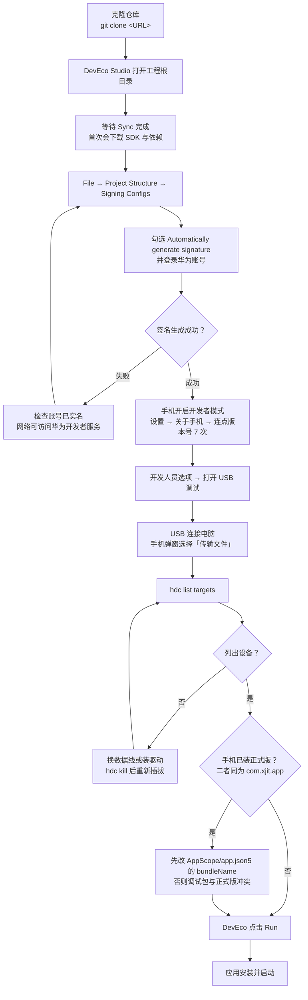

# 掌上新理工 · HarmonyOS

面向新疆理工学院的校园应用，使用 ArkTS / ArkUI，最低支持 API 23（HarmonyOS 6.1），目标与编译环境为 API 26。视觉方向为鸿蒙原生沉浸玻璃。

当前属于**开发与联调阶段，而非正式发布版本**。原生个人信息、余额、流水已有实现；其余十项业务尚待原生协议与真实账号验收。源码另含 XLLite 网关会话分支，详见当前进度中的路由说明。历史离线预览数据不代表学校业务成功。

## 安装到鸿蒙手机

本项目未上架应用市场，也**没有提供签名后的安装包**。安装方式只有一条：克隆源码，用 DevEco Studio 生成调试签名，再用 hdc 装到手机。

### 前置条件

| 项目 | 要求 |
| --- | --- |
| 操作系统 | Windows 10/11 或 macOS |
| DevEco Studio | 5.0 及以上，需能安装 HarmonyOS SDK |
| SDK | HarmonyOS 6.1（API 23）及以上；工程按 API 26 编译 |
| 手机系统 | HarmonyOS 6.1 及以上，低于 API 23 无法安装 |
| 华为账号 | 已实名，且能访问华为开发者服务，否则自动签名会失败 |
| 数据线 | 支持数据传输，纯充电线无法通信 |

### 流程



### 手动安装（不经过 DevEco 的 Run）

签名生成后，DevEco 会构建出已签名的 HAP，位于 `entry/build/default/outputs/default/`。用 hdc 直接安装：

```powershell
# 确认设备已连上
hdc list targets

# 安装已签名 HAP，-r 表示覆盖安装
hdc install -r entry\build\default\outputs\default\entry-default-signed.hap

# 启动
hdc shell aa start -a EntryAbility -b com.xjit.app
```

### 已知安装问题

- **包名冲突**：工程默认 `bundleName` 是 `com.xjit.app`，与正式版完全相同。手机若已安装正式版，调试包会与之冲突——安装被拒，或直接覆盖正式版数据。改 `AppScope/app.json5` 的 `bundleName` 为任意自定义值（例如 `com.xjit.app.debug`）即可并存，代价是无法再读取正式版已有的本地数据。
- **签名配置为空**：`build-profile.json5` 的 `signingConfigs` 是空数组，仓库里不含任何证书、私钥或 profile。必须自己生成，不要向他人索取签名材料。
- **SDK 版本不匹配**：报 `compatibleSdkVersion` 相关错误时，说明本机 SDK 低于 API 23，需在 SDK Manager 中补装 HarmonyOS 6.1 及以上。
- **首次编译慢**：Hvigor 会拉取依赖并建立缓存，属正常现象；后续增量构建通常在数十秒内完成。
- **中文路径**：ArkTS 编译器不接受中文实际路径。工程目录含中文时，改用纯英文路径，且必须是真实目录，不能用目录联接（junction）绕开。

## 项目入口

- [更新日志](CHANGELOG.md)：每次同步的变更记录。
- [当前进度与下一步](docs/PROJECT-STATUS.md)：本轮实测结论、业务缺口、交付边界。
- [目录与维护约定](docs/PROJECT-MAP.md)：源码、附属项目、工具链、历史产物和 Git 规则。
- [学校接口与认证契约](docs/SCHOOL-NATIVE-API.md)：学校直连协议与历史验收。
- [设计验收](docs/DESIGN-REVIEW-ACCEPTANCE.md)、[原生材质](docs/NATIVE-MATERIAL.md)、[实况窗申请草稿](docs/LIVEVIEW-APPLICATION.md)。

## 本机验证

在工程根目录执行，复用已安装的 Node、DevEco、SDK 和 Hvigor 缓存，无需安装新依赖：

```powershell
npm test
# 编译器不接受中文实际路径，须使用独立真实英文目录，非目录联接。
pwsh -File .\tools\build-api26.ps1 -BuildRoot 'D:\XJITApp-organize-20261016-build' -EvidenceName 'project-audit-20261016'
```

测试默认读取本机 DevEco SDK 的 TypeScript，可用 `XJIT_TYPESCRIPT_PATH` 指定已有版本。构建脚本检查现有 DevEco 和 Hvigor 6.26.8；其他机器需配置脚本参数及本地 SDK 配置。

构建默认产出未签名 HAP，正式签名配置保持空值。本地密钥、环境变量、SDK 副本、缓存、截图和大体积验收包均排除在 Git 外。

## 分支说明

| 分支 | 内容 |
| --- | --- |
| `main` | Flutter 实现，与本工程无共同提交历史 |
| `harmony` | 本工程，HarmonyOS ArkTS 实现。安装说明与更新日志均以此分支为准 |

GitHub 仓库首页默认展示 `main`，看不到本文件。查看本分支请切换分支，或直接访问 `https://github.com/AIRE1084/xllite-HarmonyOS/tree/harmony`。

## 参与与反馈

本仓库为个人维护的开发分支，接口契约、SDK 能力边界等结论均以实测与官方 `.d.ts` 标注为依据，未经验证的部分会在文档中显式标注为待确认。发现问题请提 Issue，并附上设备型号、系统版本与复现步骤。
